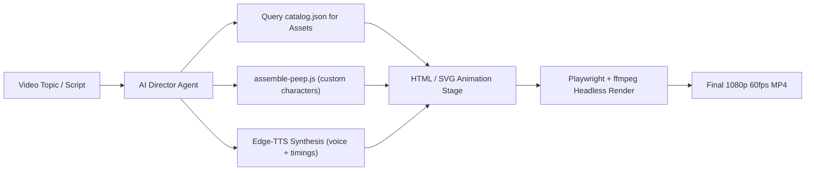

# AI-nimate 🎬✨

> **Autonomous AI-driven vector animation pipeline & Pablo Stanley asset library for explainer videos (Konglo & The Infographics Show style).**

`AI-nimate` is an end-to-end framework enabling AI agents and creators to script, assemble, voice, and render animated explainer videos using 100% free and open-source vector assets.

---

## 🌟 Key Highlights

- **100% Vector (SVG)**: Scalable to 1080p, 4K, or 8K with zero pixelation or raster artifacts.
- **Consistent Visual Aesthetic**: Curated collection of **335 hand-drawn black-ink vector assets** by **Pablo Stanley** (Open Peeps, Open Doodles, Humaaans, Blush, Happy Bunch).
- **Modular Character Assembler (`assemble-peep`)**: Zero-dependency CLI and programmatic API to combine hairstyles, facial expressions, accessories, and poses into custom characters (580,000+ possible combinations).
- **Semantic Asset Catalog (`catalog.json`)**: 6,800+ lines machine-readable index with tags, moods, styles, and viewBoxes optimized for LLM agent queries.
- **Neural Voiceover Engine (Edge-TTS)**: Multi-language neural TTS generation (tested extensively with Indonesian `id-ID-ArdiNeural` and English voices).
- **Headless Video Renderer (Playwright + ffmpeg)**: Frame-accurate 60fps MP4/WebM video recording directly from HTML/CSS/SVG stages.

---

## 📁 Repository Structure

```
AI-nimate/
├── assets/                          # Pablo Stanley Vector Asset Library (335 SVGs)
│   ├── characters/                  # Modular character components & presets
│   │   ├── faces/                   # 33 facial expressions (smile, rage, driven, etc.)
│   │   ├── hair/                    # 51 hairstyles & headwear
│   │   ├── facial-hair/             # 16 beards & mustaches
│   │   ├── accessories/             # 9 glasses & sunglasses
│   │   ├── bodies/                  # 64 bodies (bust, standing, sitting)
│   │   └── presets/                 # 16 ready-to-drop composite characters
│   ├── scenes/                      # 94 scene backgrounds
│   │   ├── cityscapes/              # 5 urban skylines & panoramas
│   │   ├── landscapes/              # 4 mountains & desert dunes
│   │   ├── interiors/               # 13 desks, offices, & living rooms
│   │   └── compositions/            # 72 narrative character doodles
│   ├── props/                       # 52 items, buildings & vehicles
│   │   ├── buildings/               # 14 skyscrapers, towers, & storefronts
│   │   ├── vehicles/                # 7 cars, buses, trucks, SUVs, UFOs
│   │   └── items/                   # 31 laptops, phones, coffee, plants, graphs
│   ├── assemble-peep.js             # Modular character compositor CLI & module
│   ├── catalog.json                 # Semantic index for AI agents
│   ├── gallery.html                 # Interactive visual browser
│   └── README.md                    # Asset catalog documentation
├── examples/
│   ├── cafe-explainer/              # 4-scene narrative explainer demo
│   │   ├── cafe-animation.html      # Responsive multi-scene HTML animation
│   │   ├── cafe-assets/             # Voiceover audio & timing metadata
│   │   ├── cafe-story.mp4           # Rendered 1080p 60fps MP4 demo
│   │   └── cafe-story.webm          # WebM format
│   └── tool-call-animation/         # 2D vector animation proof-of-concept
│       ├── animation-scene.html     # Moving glows, idle float & tool handshake
│       ├── test-animation.svg       # Standalone SVG graphic
│       ├── test-animation.mp4       # Rendered MP4 demo
│       └── test-animation.webm      # WebM format
├── scripts/
│   ├── render.js                    # Headless Playwright + ffmpeg video renderer
│   └── tts.js                       # Edge-TTS neural voiceover generator
├── docs/
│   └── WORKFLOW.md                  # Comprehensive architecture & pipeline manual
├── package.json
└── README.md
```

---

## 🚀 Quick Start

### 1. Assemble a Character

Use the zero-dependency CLI to compose custom character SVGs:

```bash
# List all available parts
node assets/assemble-peep.js --list

# Compose a sitting founder with coffee
node assets/assemble-peep.js \
  --hair bun-curly \
  --face smile \
  --body button-shirt \
  --accessory glass-round \
  --out character.svg
```

Or use programmatically in Node.js:

```javascript
const { assemblePeep } = require('./assets/assemble-peep');

const svgString = assemblePeep({
  hair: 'afro',
  face: 'driven',
  body: 'hoodie',
  facialHair: 'goatee'
});
```

### 2. Generate Voiceover Audio

Synthesize neural voiceovers via Microsoft Edge TTS:

```bash
# Indonesian Voice (id-ID-ArdiNeural)
node scripts/tts.js \
  --text "Lu punya modal 200 juta, terus mikir: buka cafe estetik pasti auto rame!" \
  --voice id-ID-ArdiNeural \
  --out voiceover.mp3

# English Voice (en-US-ChristopherNeural)
node scripts/tts.js \
  --text "Welcome to today's breakdown of automated video generation." \
  --voice en-US-ChristopherNeural \
  --out intro.mp3
```

### 3. Render HTML Animation to Video

Render any HTML/CSS/SVG canvas into a 1080p 60fps MP4:

```bash
node scripts/render.js \
  --html examples/cafe-explainer/cafe-animation.html \
  --audio examples/cafe-explainer/cafe-assets/audio/master_voiceover.mp3 \
  --duration 40.55 \
  --fps 60 \
  --output cafe-story.mp4
```

### 4. Browse Assets Visually

Launch a local web server to inspect the entire 335-asset library in your browser:

```bash
npm run gallery
# Open http://localhost:8080/gallery.html
```

---

## 🤖 Autonomous "Director Agent" Workflow

The recommended pattern for AI agents generating content end-to-end:



See [docs/WORKFLOW.md](docs/WORKFLOW.md) for full architectural guidelines and tips.

---

## 📜 Licenses & Attribution

- **Open Peeps** & **Open Doodles** by Pablo Stanley — [CC0 1.0 Universal Public Domain](https://creativecommons.org/publicdomain/zero/1.0/)
- **Humaaans** by Pablo Stanley — Free for commercial and personal use
- **AI-nimate Pipeline & Code** — [MIT License](LICENSE)
