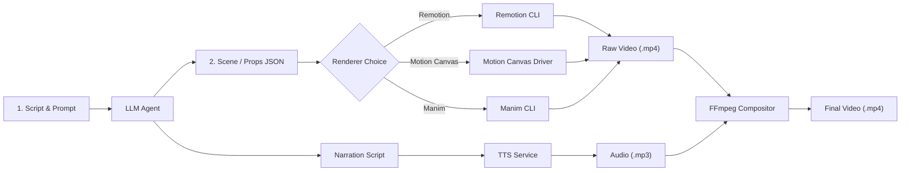

# AI-Animation-Workflows

A unified workspace for AI-driven, code-based programmatic animation and video generation pipelines. This project integrates three leading code-driven rendering engines: **Remotion**, **Motion Canvas**, and **Manim Community**, standardized under an LLM-orchestrated architecture.

---

## Tool Overview & Comparison

| Tool | Language & Runtime | Rendering Mechanism | Best Use Cases | Headless CLI Support |
| :--- | :--- | :--- | :--- | :--- |
| **Remotion** | React / TypeScript / Node | Frame-by-frame via headless Chromium | Marketing videos, UI mockups, SaaS explainers, dynamic typography, animated SVG charts, social content | Native CLI (`npx remotion render`) |
| **Motion Canvas** | TypeScript / HTML5 Canvas | Procedural generators (`yield*`) via Vite + Canvas | Algorithm visualizations, system architecture diagrams, procedural physics, interactive educational graphics | Playwright automated driver (`node render.mjs`) |
| **Manim Community** | Python (Cairo / Pango) | Vector math rendering via Cairo / OpenGL | Mathematical proofs, geometry, physics simulations, calculus, LaTeX formulas, 3Blue1Brown-style explainers | Native CLI (`manim -ql`) |

---

## When to Use Which Tool

- **Choose Remotion** when:
  - Your animation relies on web primitives (React components, CSS flexbox/grid, HTML, SVG).
  - You need declarative component reusability and native headless server-side rendering in CI/CD.
  - You want to package reusable layout templates with parameterized text, colors, and media overlays.

- **Choose Motion Canvas** when:
  - You need precise timeline coordination where multiple elements smoothly interpolate together using generator loops (`yield* all(...)`).
  - You are illustrating algorithms, data structures, or code execution flows.
  - You value having an interactive browser editor during development to scrub frames and adjust easing.

- **Choose Manim** when:
  - You are visualizing mathematical formulas, coordinate systems, vector fields, or geometry.
  - You need first-class LaTeX equation rendering (`MathTex`) and matrix transformations.
  - Your pipeline is native Python.

---

## The Shared AI Pipeline Architecture

All three tools share the same end-to-end automated generation pipeline:



### Pipeline Stages

1. **Script & Visual Direction**:
   The LLM ingests a brief and drafts the narrative script, scene breakdown, and timing estimates.
2. **Structured Props / Scene JSON**:
   Instead of writing raw animation code from scratch, the LLM outputs strict JSON props (titles, colors, shape parameters, timings, coordinates) conforming to each renderer's schema.
3. **Deterministic Video Rendering**:
   The code-driven renderer reads the JSON props and generates high-fidelity MP4 video frames deterministically.
4. **TTS Narration & FFmpeg Compositing**:
   - Voiceover audio is synthesized via TTS (e.g. OpenAI TTS, ElevenLabs, Kokoro).
   - FFmpeg aligns audio and video tracks, adds background music, and handles subtitle burn-in:
     ```bash
     ffmpeg -i raw_video.mp4 -i voiceover.mp3 -c:v copy -c:a aac -shortest final_render.mp4
     ```

---

## Project Structure

```text
AI-Animation-Workflows/
├── remotion/               # Remotion React/TypeScript workspace
│   ├── src/                # Root, Composition, and StickFigure components
│   ├── props.json          # LLM parameter interface
│   ├── remotion.config.ts  # Headless browser configuration
│   └── README.md           # Render commands & LLM integration guide
├── motion-canvas/          # Motion Canvas TypeScript workspace
│   ├── src/                # Project definition, scenes, and props.json
│   ├── render.mjs          # Headless Playwright rendering script
│   ├── vite.config.ts      # Vite + @motion-canvas/ffmpeg configuration
│   └── README.md           # Render commands & LLM integration guide
├── manim/                  # Manim Community Python workspace
│   ├── scene.py            # Parameterized Manim Scene class
│   ├── props.json          # LLM parameter interface
│   └── README.md           # CLI commands & dependency guide
├── package.json            # Root npm workspaces configuration
└── .gitignore              # Ignores build artifacts, venvs, and node_modules
```

---

## Quickstart

### Remotion
```bash
cd remotion
npm run render
# Outputs to remotion/out/demo.mp4
```

### Motion Canvas
```bash
cd motion-canvas
npm run render
# Outputs to motion-canvas/output/project.mp4
```

### Manim
```bash
cd manim
manim -ql scene.py MinimalScene
# Outputs to manim/media/videos/scene/480p15/MinimalScene.mp4
```
